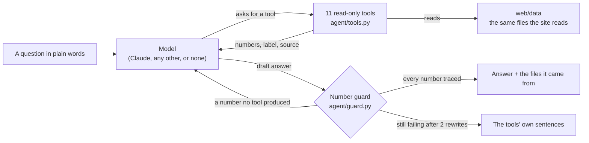

# The agent: ask in your own words, get only what the NASA data says

Lapse has two doors into the same hub. The website is the door for people. The
agent is the door for questions in plain language, and for other AI assistants.

Behind both doors are the same published files, computed from two NASA records
(AIRS and MERRA-2). The agent can read those files and nothing else.



## Try it now (no account, no key)

```bash
python -m lapse agent "Is the Arctic warming?"
python -m lapse agent "What is happening 32 km up?" --steps
python -m lapse agent "Do the methods agree at 21 km?"
python -m lapse agent                      # a conversation; empty line to stop
```

With no model configured, a small rule-based planner picks the tool and the answer
is the tool's own sentence. A real run:

```
$ python -m lapse agent "What is happening 32 km up?" --steps
Averaged over the whole globe, about 32 km up (10 hPa): Clear change. The air is
cooling: -0.59 °C per ten years, very likely between -0.71 and -0.47. Over the 24.1
years of data that adds up to about -1.4 °C. 3 of 3 sound methods find a change in
this direction. Both datasets pass the test, in the same direction, with overlapping
ranges. Data: AIRS (NASA Aqua satellite), 2002 to 2026.

Read from:
  AIRS3STM v7.0  web/data/trend/airs/t/full__none__robust.json
Number check: passed. Every number above is in the files listed.

Model: rules (no language model)
  trend_at({"km": 32.0}) -> ok

$ python -m lapse agent "Who won the game last night?"
I can only answer from NASA's AIRS and MERRA-2 records: how air temperature, ozone
and water vapor are changing at different heights. Try: "Is the Arctic warming?",
"What is happening 30 km up?" or "Do the methods agree at 21 km?"
```

## Use a language model

Set one key in your own terminal. The harness reads it from the environment. It is
never printed, logged or written to a file.

| To use | Set | Model id |
|---|---|---|
| Claude | `ANTHROPIC_API_KEY` | `LAPSE_MODEL` (default `claude-sonnet-5-5`) |
| Any model on OpenRouter | `OPENROUTER_API_KEY` | `LAPSE_MODEL` (required) |
| OpenAI | `OPENAI_API_KEY` | `LAPSE_MODEL` (required) |
| A local or other OpenAI-compatible server | `LAPSE_BASE_URL` (and `LAPSE_API_KEY` if needed) | `LAPSE_MODEL` (required) |

```bash
export ANTHROPIC_API_KEY="..."             # in your own terminal only
python -m lapse agent "Is the stratosphere cooling everywhere, or only in some places?" --steps
python -m lapse agent --model rules "..."  # force the no-model planner
```

The model writes the sentences. It does not supply the facts. If the model is
unreachable or the key is wrong, the planner answers instead and a note says so, so a
demo cannot fail because of a network.

## What the agent can and cannot do

| | |
|---|---|
| **Can** | Call the 11 read-only tools below. |
| **Cannot** | Reach the internet, read any other file, write anything, or run code. No such tool exists, and a call to a tool that is not on the list is refused without being run. |
| **Cannot** | Show a number that no tool produced. The number guard checks every draft. |
| **Cannot** | Answer without reading data first. A reply with no successful tool call behind it is never shown. |
| **When it fails** | After two rejected rewrites the model's text is discarded and the tools' own sentences are shown. |
| **Limits** | At most 8 model turns per question and 6 tool calls per turn. |

## The tools

| Tool | What it answers |
|---|---|
| `list_options` | What can be asked: measures, datasets, places, heights, methods, labels. |
| `trend_at` | One place, one height: rate per ten years, range, total change, label, reason. |
| `profile` | The whole column above one place: every height, where the direction flips. |
| `compare_methods` | The same point under every method, and how many sound methods agree. |
| `compare_datasets` | The same point in AIRS and in MERRA-2, over the years both cover. |
| `compare_places` | One height across every region. |
| `opposite_pairs` | Where two proven changes point in opposite directions. |
| `effect_of_events` | The trend with and without volcano months, and the size of any data-source jump. |
| `yearly_history` | The record year by year, compared with normal. |
| `published_checks` | Our numbers against results published by other scientists. |
| `glossary` | Plain-language meanings of the words used. |

Every result carries `summary` (a sentence built by the tool, not by a model) and
`source` (the NASA product and the file). The allowed values of each argument are read
from the published files, so a new dataset or method appears in the tools by itself.

To add a tool: write a function in `pipeline/lapse/agent/tools.py` and add one entry
to `TOOLS`. The harness, the command line and the MCP server all pick it up.

## The number guard

A language model can wrap a made-up number in a confident sentence. The guard makes
that impossible to miss. Every number in a drafted answer must be one of:

- a number in a tool result from this turn, copied as written;
- that number rounded, with at least two significant digits kept (`-0.5913` may be
  written `-0.59`, not `-0.6`);
- a number the person typed in their own question.

A number written with a sign must match the sign of the tool's number. Names such as
`MERRA-2`, `CO2` or `v7.0` are not treated as numbers.

| Draft | Tool result has | Verdict |
|---|---|---|
| "cooling by 0.59 °C per ten years" | `-0.5913` | Passes |
| "about 0.6 °C per ten years" | `-0.5913` | Rejected: too coarse |
| "+0.59 °C per ten years" | `-0.5913` | Rejected: wrong sign |
| "about 2 °C in total" | `-1.4` | Rejected: the model did arithmetic |
| "since 1979" | record starts 2002 | Rejected: invented |

**What the guard does not do.** It proves that a number came from the data. It does
not prove the number is attached to the right place or height, and it does not check
words. That is why every answer also lists the files it was read from, and why the
tools return finished sentences the model can lean on.

## Use Lapse from Claude or any other MCP client

The same tools are served over the Model Context Protocol, so an assistant you
already use can answer from this data.

```bash
python -m lapse mcp          # waits silently for a client on stdin/stdout
```

Claude Code, from this folder (the repository's `.mcp.json` does the same, as long as `python` is the one with Lapse installed):

```bash
claude mcp add lapse -- python -m lapse mcp
```

Claude Desktop: add this to `claude_desktop_config.json`, using the full path of the
Python that has Lapse installed, then restart the app.

```json
{
  "mcpServers": {
    "lapse": { "command": "/full/path/to/python", "args": ["-m", "lapse", "mcp"] }
  }
}
```

An outside client is not our harness, so the guard cannot be forced on it. Instead
the server states the rules in its instructions and offers a twelfth tool,
`check_answer`, which runs the guard on a draft against everything the server has
returned in that session.

The server uses only the Python standard library and speaks the `initialize`
handshake (protocol revisions 2024-11-05 to 2025-11-25).

## What was tested, and what was not

Tested (`pipeline/tests/test_agent.py`, 46 tests):

- every tool on a synthetic site, and by hand on the real data;
- the guard: copies, rounding, signs, names, ranges, invented numbers;
- the harness with a scripted model: a good answer, an invented number that gets
  rewritten, a model that keeps inventing, a call to a tool that does not exist, an
  answer with no data behind it, the turn and call limits, a model that crashes;
- the planner on 19 kinds of question, 4 of them off-topic;
- the Claude and OpenAI-style adapters with the HTTP call replaced, plus the whole loop
  over real HTTP against a local stand-in server;
- the MCP server with the official MCP Python client, in both of its connection modes.

Not tested: a live language model. No API key was available where this was built, so
the adapters follow the providers' published request formats but have not yet made a
real call. The first live run is yours; `--steps` shows what the model did.

## Honest limits

- The planner understands simple questions only. It never invents, but it can pick a
  less useful tool than a model would.
- A model can still phrase a true number misleadingly. The guard checks numbers, not
  meaning.
- The agent knows nothing outside these files: no weather, no forecasts, no causes
  beyond what a tool states.

## References

- Model Context Protocol, "Connect to local MCP servers": https://modelcontextprotocol.io/docs/2026-07-28/develop/connect-local-servers
- Claude Code, "Connect Claude Code to tools via MCP": https://code.claude.com/docs/en/mcp
- Claude API reference, "Create a Message": https://platform.claude.com/docs/en/api/messages/create
