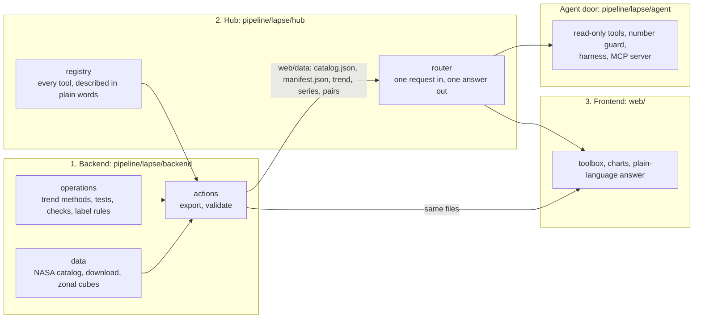

# Architecture

Three layers. Each one only talks to the layer next to it. The hub has two doors:
the website for people, and the agent for plain-language questions and other AI assistants.



## 1. Backend: data, operations, actions

| Part | Folder | Job |
|---|---|---|
| Data | `backend/data/` | Search NASA's catalog, download only the needed slices, reduce to latitude bands, store as cubes. |
| Operations | `backend/operations/` | Pure functions: remove the seasons, measure a trend, test it, check for jumps, assign a label. No files, no network. |
| Actions | `backend/actions/` | Run the operations over the data and write the results: `export` for the site, `validate` against published science. |

## 2. Hub: every tool in one place

The idea is the one behind a model router: many tools behind one door, and the user
decides which to use, or lets the hub decide.

| Tool kind | Choices today | Auto picks |
|---|---|---|
| Data source | AIRS satellite, MERRA-2 reanalysis | The satellite if it measures this, otherwise the reanalysis |
| Method | Robust, Classic straight line, Year by year, Textbook (comparison only) | Robust |
| Years | Full record, or the years two datasets share | The shared years, so a second dataset can confirm |
| Checks | False-alarm control, second dataset, volcano months, data-source jumps | Always on |

Two rules make the tools interchangeable:

1. **One input shape, one output shape.** Every method takes `y[time, cells]` and month
   numbers, and returns `slope, lo, hi, p, r1, n`. See `backend/operations/stats.py`.
2. **One request shape, one answer shape.** A request names a measure, a place, a height
   and optionally the tools. The answer always carries the rate, its range, the label,
   the reason, and how many sound methods agree.

Adding a tool is one entry in `hub/registry.py`. The export, the router, the website's
toolbox and the methods page all read the registry, so nothing else changes.

### Ask the hub from a terminal

```bash
python -m lapse tools
python -m lapse ask --where arctic --km 32
python -m lapse ask --what qv --where tropics --km 5 --method classic
```

### Ask the hub from Python

```python
from lapse.hub import router
router.answer({"what": "t", "where": "global", "km": 32, "method": "yearly"})
```

### Auto is decided in one place

`hub/registry.auto_choices` holds the two Auto rules (satellite first; the years two
datasets share). The export publishes the result as `manifest.auto`. The router, the
website and the agent read it. None of them works it out again.

## The agent door

`pipeline/lapse/agent/` lets a language model, or no model at all, answer questions in
plain words. It is bound by three rules: it can only call the read-only tools in
`agent/tools.py`; every number in its answer must come from a tool result
(`agent/guard.py`); and an answer with no data behind it is never shown. The same tools
are served to outside assistants over MCP. Details: [agent.md](agent.md).

## 3. Frontend: visualize and explain

`web/` is a static site with no build step. It reads `catalog.json` to draw the toolbox,
builds file paths from the catalog's routes, and never computes a trend, a range or a
label. Plain words come from `web/content/glossary.json` and from the label texts in
`pipeline/lapse/config.py`.

## Reproducible

The four reduced cubes are in `data/zonal` (about 11 MB). `python -m lapse verify`
recomputes every published file from them and compares, number by number. GitHub runs
it on every push, so the site cannot drift from the code.

## Why precomputed

Every combination of data source, method, years and months is computed ahead of time
(about one minute for everything) and published as files. The site has no server to
crash during a demo. The router reads the same files, so a live API can be added later
by serving `router.answer` without changing either side.
